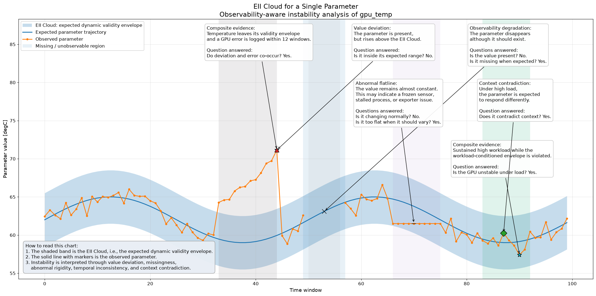

# EII_cloud - Early Instability Indicator Cloud

Context-aware, explainable instability detection, evidence fusion and publication-quality
visualization for predictive-maintenance (PdM) research.

An **EII Cloud** is the *expected dynamic validity envelope* of a parameter, possibly
conditioned on operating context. An instability is a departure from an explicitly
defined expected relationship, not merely from an absolute threshold. The library needs
no machine-learning training or forecasting to find one, and every finding carries the
evidence needed to reproduce it.



## Install

```bash
pip install eii-cloud            # core (numpy, pandas, matplotlib, pyyaml)
pip install "eii-cloud[all]"     # + scikit-learn models, Pillow for TIFF export
```

Python 3.10+.

## Sixty-second tour

```python
import eii_cloud as eii
from eii_cloud.experiments import make_reference_scenario

sc = make_reference_scenario(seed=0)          # synthetic GPU scenario with known ground truth
engine = eii.EIIEngine(
    envelopes=sc.envelopes,                   # {"gpu_temp_static": {...}, "gpu_temp_ctx": {...}}
    detectors=[
        {"type": "threshold", "parameter": "gpu_temp", "envelope": "gpu_temp_static"},
        {"type": "missingness", "parameter": "gpu_temp"},
        {"type": "flatline", "parameter": "gpu_temp", "min_run": 8, "tolerance": 0.0},
        {"type": "context_contradiction", "parameter": "gpu_temp"},
    ],
    rules=sc.rules,                           # composite evidence rules (YAML-loadable)
    context=sc.context,                       # regimes + contextual expectations
)
result = engine.run(sc.dataset, reference=sc.reference)
print(result.summary())

chart = eii.EIICloudChart(sc.dataset, result, "gpu_temp", envelope="gpu_temp_static", mode="annotated")
fig = chart.render()
eii.ExportManager("out").export(fig, "gpu_temp", formats=("svg", "pdf", "tiff", "png"))
eii.write_annotations_json(result, "out/gpu_temp_annotations.json", sc.dataset, "gpu_temp")
```

Or from the shell:

```bash
eii-cloud demo --out demo_run           # charts (SVG/PDF/TIFF/PNG), result.json, annotations, manifest
eii-cloud protocols all                 # EXP-00/01/03/05/06 validation reports
eii-cloud validate-rules examples/rules/gpu_instability.yaml
eii-cloud reproduce demo_run            # re-run from the saved manifest, compare finding ids
```

## What is in the box

| Area | Contents |
|---|---|
| **Data** | `EIIDataset` (telemetry + context + acquisition schedule + quality + events), content hashes, save/load with manifest |
| **Envelopes** | `fixed_bounds`, `scheduled_bounds`, `rolling_robust` (causal), `contextual_quantiles`, `regime_lookup`, `regression_residual`, `physical_constraints`, `external_envelope`, `forecast_interval` - each records method, reference population, per-sample support and empirical coverage |
| **Detectors** (A1–A6) | threshold / value deviation, robust deviation, EWMA, CUSUM, flatline, missingness, rate of change, change point, context contradiction, cross-signal constraint; registry for your own |
| **Rules** (A7) | Three-valued (Kleene) logic with `AND OR NOT BEFORE AFTER WITHIN DURING OVERLAPS PERSISTS_FOR COUNT_WITHIN MISSING_WHEN_EXPECTED CONTRADICTS_CONTEXT`; YAML and Python builders; cycle detection; evidence provenance |
| **Findings** | `Finding` with stable ids, category, interval, severity, TRUE/FALSE/UNKNOWN status, evidence, context snapshot, reference id, provenance |
| **Charts** | `EIICloudChart` (annotated / clean / flags_only / annotations_json), score, control, change-point, missingness timeline, event sequence, multi-signal, context comparison, detector comparison, evidence graph |
| **Export** | SVG (keeps annotation ids), PDF, TIFF, PNG, JSON sidecars; identical ids across formats |
| **Evaluation** | event recall/precision, exact-interval accuracy, delays, alert burden, abstention rate, macro-F1 / balanced accuracy, bootstrap CIs over independent units |
| **Experiments** | synthetic reference scenario with exact ground truth, fault injection, `ExperimentRunner` with reproduce-from-manifest, protocols EXP-00/01/03/05/06 |
| **Streaming** | `StreamingEngine` replay with event-time watermark; finalised findings equal batch (EXP-06) |

## Three-valued semantics in one paragraph

Every condition evaluates per sample to TRUE, FALSE or UNKNOWN. A missing measurement, an
envelope without reference support, or an event source outside its declared coverage
yields UNKNOWN, and `NOT` never turns UNKNOWN into TRUE. Therefore *"no GPU error was
logged"* is not evidence while the log collector is down, and *"missing when expected"*
is a monitoring finding, distinct from a scheduled gap (`dataset.expected == False`).

## Defining rules

```yaml
schema_version: "1.0"
rules:
  - id: instability_under_load
    category: composite_evidence
    severity: critical
    parameters: [gpu_temp, gpu_util]
    expression:
      and:
        - persists_for: {condition: {signal: gpu_util, op: ">=", value: 85}, window: 3}
        - outside_envelope: {parameter: gpu_temp, envelope: gpu_temp_ctx}
  - id: deviation_then_gpu_error
    expression:
      before:
        condition: {outside_envelope: {parameter: gpu_temp, envelope: gpu_temp_static}}
        next: {event: gpu_xid}
        window: 12
```

The same in Python:

```python
from eii_cloud import C, Rule
r = Rule("instability_under_load",
         C.signal("gpu_util", ">=", 85).persists_for(3) & C.outside_envelope("gpu_temp", "gpu_temp_ctx"),
         severity="critical", parameters=["gpu_temp", "gpu_util"])
```

Operator semantics are documented in `eii_cloud/rules/nodes.py`. Rule files are loaded
with `yaml.safe_load` and compiled through a closed vocabulary; no code is executed.

## Adding a detector without touching the core

```python
from eii_cloud import BaseDetector, Category, TruthSeries, register_detector

@register_detector("my_spike")
class SpikeDetector(BaseDetector):
    category = Category.TEMPORAL_INSTABILITY
    def __init__(self, parameter, jump=5.0, **kw):
        super().__init__(parameter, jump=jump, **kw); self.jump = jump
    def evaluate(self, dataset, envelopes, context):
        import numpy as np
        x = dataset.value(self.parameter); d = np.abs(np.diff(x, prepend=x[0]))
        return TruthSeries.from_bool(d > self.jump, np.isnan(d)), d

engine.add_detector({"type": "my_spike", "parameter": "gpu_temp", "jump": 4})
```

## Reproducibility

`ExperimentRunner(config, out_dir).run()` writes the dataset (with SHA-256 manifest), the
reference data, `result.json`, the rules, annotation JSON, every chart in every format and a
`manifest.json` with config hashes and finding ids. `ExperimentRunner.reproduce(out_dir)`
re-runs it and reports whether the finding ids are identical.

## Scientific caveats baked into the API

* A validity envelope is not a confidence interval; its method, reference population,
  support and empirical coverage are reported in `result.envelopes[...]`.
* Insufficient reference support produces NaN bounds and UNKNOWN detections, never an
  invented range.
* Correlated evidence is combined logically, never multiplied as independent probabilities.
* Composite rules are operational definitions; they do not establish causality.
* Synthetic injection measures algorithmic robustness; real diagnostic claims need
  independent evidence.

## Development

```bash
pip install -e ".[dev]"
pytest
python -m build
```

License: MIT.
